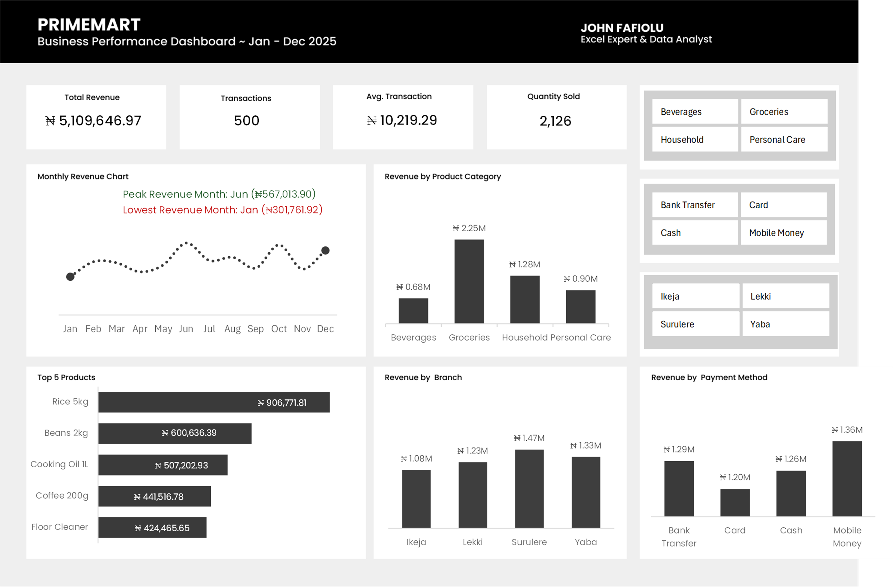

# PrimeMart Business Sales Management & Interactive Reporting System

## Project Overview

The PrimeMart Business Sales Management & Interactive Reporting System is an Excel-based business intelligence project developed to help a fictional retail business monitor sales performance, evaluate product and branch contributions, and generate actionable business insights.

The project involved transforming raw transactional sales data into a structured, cleaned, and validated dataset, followed by the development of an interactive reporting dashboard.

The dashboard provides management with visibility into key performance indicators (KPIs), monthly revenue trends, product category performance, top-performing products, branch revenue contributions, and payment method distribution.

Interactive slicers allow users to explore business performance across different branches, product categories, and payment methods without modifying the underlying data or dashboard structure.

## Dashboard Preview

---

## Business Problem

Retail businesses generate large volumes of transactional data but may struggle to convert this information into meaningful insights for decision-making.

Without an organised reporting system, management may find it difficult to:

- Monitor overall sales performance.
- Identify high-performing products and categories.
- Compare revenue contributions across branches.
- Track monthly revenue movements.
- Understand revenue distribution across payment methods.
- Identify patterns that can inform inventory and operational decisions.

PrimeMart requires a centralised reporting solution that transforms raw sales records into useful business information.

## Project Objectives

The primary objectives of this project were to:

1. Clean and organise raw transactional sales data.
2. Validate data accuracy and consistency.
3. Calculate key business performance indicators.
4. Analyse revenue across products, categories, branches, and payment methods.
5. Examine monthly revenue trends.
6. Identify the highest- and lowest-revenue months.
7. Develop an interactive Excel dashboard for business reporting.
8. Enable management to explore sales performance using interactive filters.

---

## Dataset Overview

The project uses a fictional retail sales dataset containing **500 transactional records** covering January to December 2025.

The dataset represents transactions across four retail branches and multiple product categories.

### Dataset Columns

| Column | Description |
|---|---|
| Transaction_ID | Unique identifier for each transaction |
| Date | Date of transaction |
| Customer_ID | Identifier assigned to each customer |
| Product | Product purchased |
| Category | Product category |
| Quantity | Number of units purchased |
| Unit_Price | Price per unit |
| Total_Amount | Total transaction amount |
| Payment_Method | Method used to complete payment |
| Branch | Retail branch where the transaction occurred |
| Sales_Representative | Representative associated with the transaction |

### Dataset Structure

- Total records: 500
- Reporting period: January–December 2025
- Product categories: 4
- Unique products: 18
- Branches: 4
- Payment methods: 4

---

## Tools and Technologies

The project was completed using Microsoft Excel.

Key Excel features and functions used include:

- Excel Tables
- Data Cleaning and Transformation
- Conditional Formatting
- Data Validation
- Excel Formulas
- PivotTables
- PivotCharts
- Interactive Slicers
- Custom Number Formatting
- INDEX and MATCH
- MAX and MIN
- SUM and COUNTA
- UNIQUE
- TRIM and PROPER
- TEXT

---

## Data Cleaning and Preparation

The raw dataset was inspected and cleaned before analysis to improve data consistency and reliability.

### Data Quality Issues Identified

The initial inspection revealed:

- Missing Customer_ID values.
- One missing Sales_Representative value.
- Inconsistent capitalisation and unnecessary spaces in some Category entries.
- Inconsistent formatting in some Branch entries.
- A payment method entry with inconsistent capitalisation.

### Cleaning Procedures

The following procedures were performed:

1. **Missing Values:** Missing Customer_ID and Sales_Representative entries were replaced with "Unknown" to preserve transaction records without inventing customer or employee information.

2. **Text Standardisation:** TRIM and PROPER functions were used to remove unnecessary spaces and standardise text formatting.

3. **Duplicate Checks:** Transaction_ID values were checked using COUNTIF to identify duplicate transaction records. No duplicate transaction IDs were identified.

4. **Revenue Validation:** Total_Amount values were recalculated using Quantity multiplied by Unit_Price. The recalculated values were compared with the original amounts, and all comparisons returned TRUE.

5. **Date Validation:** The date column was checked to confirm that the values were recognised as valid Excel dates.

6. **Data Completeness:** Numeric fields were checked to confirm that all 500 records contained valid Quantity and Unit_Price values.

### Data Validation Results

| Validation Check | Result |
|---|---|
| Total transaction records | 500 |
| Duplicate Transaction_IDs | None identified |
| Missing Customer_ID values | Replaced with Unknown |
| Missing Sales_Representative values | Replaced with Unknown |
| Quantity validation | 500 valid numeric records |
| Unit_Price validation | 500 valid numeric records |
| Revenue calculation | All comparisons TRUE |
| Date validation | All dates recognised as valid Excel dates |

---

## Data Analysis

The cleaned dataset was analysed to understand PrimeMart's overall sales performance and identify important business patterns.

### 1. Key Performance Indicators

The following KPIs were calculated:

| Metric | Result |
|---|---:|
| Total Revenue | ₦5,109,646.97 |
| Total Transactions | 500 |
| Average Transaction Value | ₦10,219.29 |
| Total Quantity Sold | 2,126 |
| Unique Products | 18 |

### 2. Revenue by Product Category

The analysis examined revenue contributions across the four product categories.

| Product Category | Revenue |
|---|---:|
| Groceries | ₦2,250,926.94 |
| Household | ₦1,283,032.16 |
| Personal Care | ₦896,576.98 |
| Beverages | ₦679,110.89 |

**Key Findings:**

- Groceries generated the highest revenue, contributing approximately 44.05% of total revenue.
- Household products accounted for approximately 25.11%.
- Personal Care contributed approximately 17.55%.
- Beverages generated the lowest revenue contribution at approximately 13.29%.

Groceries represented the largest revenue-generating category during the reporting period.

### 3. Revenue by Branch

Branch performance was evaluated to understand how revenue was distributed across PrimeMart's four locations.

| Branch | Revenue |
|---|---:|
| Surulere | ₦1,465,127.29 |
| Yaba | ₦1,330,931.36 |
| Lekki | ₦1,231,133.10 |
| Ikeja | ₦1,082,455.22 |

**Key Findings:**

- Surulere recorded the highest revenue, contributing approximately 28.67% of total revenue.
- Yaba ranked second with approximately 26.05%.
- Lekki contributed approximately 24.09%.
- Ikeja recorded the lowest revenue contribution at approximately 21.19%.

The findings highlight differences in revenue contributions across the four branches. Further analysis of transaction volumes, customer traffic, and operating costs would be required to assess overall branch efficiency.

### 4. Revenue by Payment Method

The analysis examined revenue generated through the different payment channels.

| Payment Method | Revenue |
|---|---:|
| Mobile Money | ₦1,361,414.72 |
| Bank Transfer | ₦1,292,513.32 |
| Cash | ₦1,259,510.49 |
| Card | ₦1,196,208.44 |

**Key Findings:**

- Mobile Money recorded the highest revenue contribution at approximately 26.64%.
- Bank Transfer contributed approximately 25.30%.
- Cash accounted for approximately 24.65%.
- Card payments contributed approximately 23.41%.

Revenue was relatively evenly distributed across the four payment methods.

However, revenue contribution alone does not establish which payment method was used most frequently. Transaction counts would be needed for that comparison.

### 5. Monthly Revenue Trend

Monthly revenue was analysed to examine changes in sales performance throughout 2025.

**Key Findings:**

- June recorded the highest monthly revenue of ₦567,013.90.
- January recorded the lowest monthly revenue of ₦301,761.92.
- The difference between the highest- and lowest-revenue months was ₦265,251.98.

The findings indicate variations in monthly revenue throughout the year.

Further investigation into transaction volumes, promotional activities, customer demand, and seasonal patterns would help explain the observed fluctuations.

### 6. Top Five Revenue-Generating Products

Products were ranked according to their total revenue contributions.

| Rank | Product | Revenue |
|---:|---|---:|
| 1 | Rice 5kg | ₦906,771.81 |
| 2 | Beans 2kg | ₦606,636.39 |
| 3 | Cooking Oil 1L | ₦507,202.93 |
| 4 | Coffee 200g | ₦441,516.78 |
| 5 | Floor Cleaner | ₦424,465.65 |

**Key Findings:**

- Rice 5kg was the highest revenue-generating product.
- Beans 2kg ranked second.
- The five leading products contributed approximately 56.5% of total revenue.

These products represent important contributors to overall sales revenue and may deserve closer inventory monitoring.

Revenue contribution does not necessarily indicate profitability because product costs and operating expenses were not included in the dataset.

---

## Interactive Dashboard

An interactive Excel dashboard was developed to provide a consolidated view of PrimeMart's sales performance.

### Dashboard Components

**1. KPI Cards**

The dashboard displays four major business performance indicators:

- Total Revenue
- Total Transactions
- Average Transaction Value
- Total Quantity Sold

**2. Monthly Revenue Trend**

A line chart visualises monthly revenue movements throughout 2025.

**3. Revenue by Product Category**

A chart compares revenue contributions across the four product categories.

**4. Top Five Products**

A ranked chart highlights the five products generating the highest revenue.

**5. Revenue by Branch**

A chart compares revenue contributions across the four retail branches.

**6. Revenue by Payment Method**

A chart displays revenue distribution across the available payment channels.

**7. Dynamic Monthly Performance Indicators**

INDEX, MATCH, MAX, MIN, and TEXT functions were used to identify and display the peak and lowest revenue months alongside their corresponding revenue values.

**8. Interactive Slicers**

Three slicers were implemented:

- Branch
- Product Category
- Payment Method

These slicers allow users to filter the dashboard and explore different combinations of business performance.

The slicers were connected to the relevant PivotTables and charts, including the KPI reporting calculations.

**9. Worksheet Protection**

The dashboard worksheet was protected to reduce accidental modification of its layout and formulas while retaining slicer interaction.

---

## Key Business Insights and Recommendations

Based on the analysis, the following recommendations can be considered:

### 1. Prioritise Inventory Monitoring for High-Revenue Products

Rice 5kg, Beans 2kg, and Cooking Oil 1L were among the leading revenue-generating products.

Management should monitor the availability of these products to reduce potential stockout risks.

### 2. Investigate Category Performance

Groceries generated the highest revenue, while Beverages recorded the lowest.

Management could investigate product demand, pricing, stock availability, and customer preferences to identify opportunities for improving category performance.

### 3. Investigate Branch Revenue Differences

Surulere generated the highest revenue, while Ikeja recorded the lowest.

Further analysis of customer traffic, transaction frequency, operating expenses, and local demand could help explain these differences.

### 4. Monitor Monthly Sales Performance

June recorded the highest revenue, while January recorded the lowest.

Management should investigate the factors contributing to these fluctuations and use the findings to improve sales planning.

### 5. Maintain Multiple Payment Options

Revenue was relatively evenly distributed across the four payment methods.

Maintaining multiple payment channels can help accommodate different customer preferences.

---

## Project Limitations

Although the project provides useful insights into sales performance, some limitations should be considered:

- The dataset is fictional and represents a simulated retail business environment.
- Product costs and operating expenses were unavailable, so profitability could not be determined.
- Customer-level purchasing behaviour was not explored in depth.
- The dataset does not contain promotional or marketing campaign information.
- Revenue analysis alone cannot establish the causes of monthly or branch-level performance differences.

These limitations provide opportunities for further analysis if additional business data becomes available.

---

## Conclusion

The PrimeMart Business Sales Management & Interactive Reporting System demonstrates how Microsoft Excel can be used to transform raw transactional data into a structured business reporting solution.

Through data cleaning, validation, exploratory analysis, PivotTables, PivotCharts, formulas, and interactive slicers, the project provides a consolidated view of sales performance across products, categories, branches, payment methods, and reporting periods.

Beyond presenting figures, the project demonstrates how analytical findings can support business monitoring, inventory planning, and operational decision-making.

---

## Project Files

The project includes:

- Raw transactional sales dataset.
- Cleaned sales dataset.
- Excel analysis workbook.
- Interactive sales dashboard.
- Project documentation.

---

## Author

**John Fafiolu**

Data Analyst | Statistics Graduate
